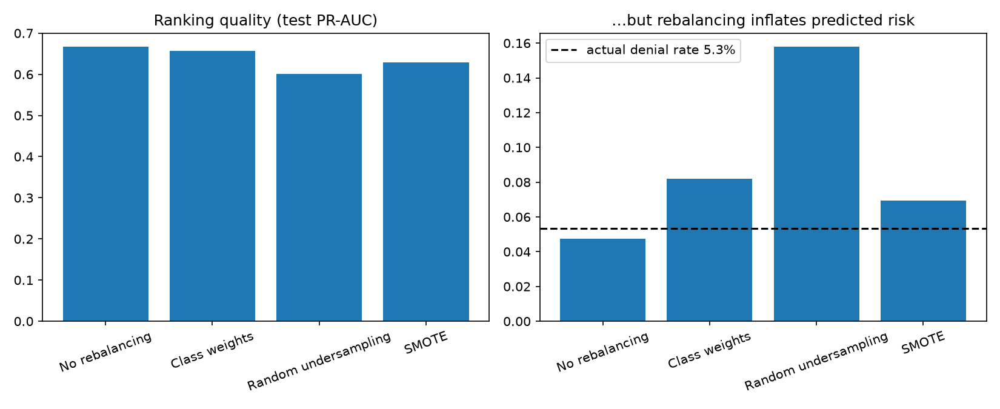
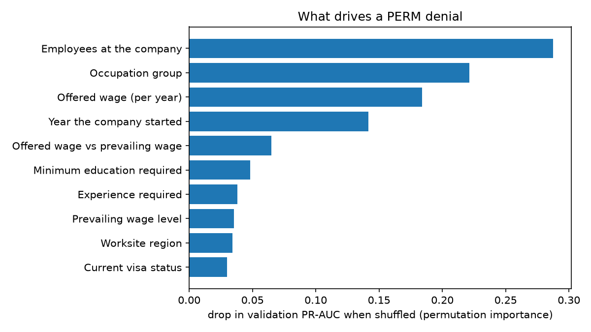

Before a US employer can sponsor a foreign worker for a green card, the Department of Labor has to
certify the job. This is called PERM labor certification. In fiscal year 2024, **5.3%** of the
decided applications were denied.

That's a textbook imbalanced classification problem, and the textbook answer is to rebalance:
oversample the rare class with SMOTE, undersample the common one, or weight the classes. My
original coursework (the EasyVisa project in my UT Austin Post-Graduate Program in AI & Machine
Learning) did exactly that.

When I rebuilt the project on the Department of Labor's public data, I compared those techniques
head to head. The result surprised me. [Try the model](https://srikarbolleddu.com/projects/visa-approval-prediction#demo)
or [read the code](https://github.com/srikarbolleddu/ml-visa-approval).

## The setup

- **Data:** 90,379 decided PERM applications from the DOL's FY2024 disclosure file (public domain).
  Withdrawn cases were dropped, since they have no decision.
- **Inputs (16):** about the employer (size, founding year), the job offer (occupation group, wage,
  wage vs. the prevailing wage, wage level, required education, experience and training, region)
  and the worker (education, current visa, whether they're employed, whether they gained the
  required experience at the same employer).
- **Model:** scikit-learn's `HistGradientBoostingClassifier`, with a small hyperparameter search
  per strategy.
- **Split:** 60% train, 20% validation, 20% test, stratified. Every choice (hyperparameters,
  strategy, decision cutoff) was made on validation. The test set was used once.

The four strategies, all applied **only to the training data**:

```python
if strategy == "Random undersampling":
    sampler = RandomUnderSampler(sampling_strategy=0.5, random_state=SEED)
elif strategy == "SMOTE":
    # SMOTE-NC: interpolates numbers, takes the most common neighbour value for categories
    sampler = SMOTENC(categorical_features=cat_columns, sampling_strategy=0.5, random_state=SEED)
# "Class weights" sets class_weight="balanced" on the model; "No rebalancing" does nothing.
```

Resampling the validation or test sets would make the evaluation lie about the real world, so
they always keep the true 5.3% denial rate.

## How to score an imbalanced model

Accuracy is useless here: predicting "certified" for everyone scores 94.7%. I used:

- **PR-AUC** (average precision) to pick hyperparameters and the strategy. It measures how well the
  model ranks denials above certifications, independent of any cutoff.
- A **tuned cutoff** per strategy, chosen on validation to maximize F1 for denials. The default 0.5
  means nothing when only 1 in 19 cases is positive.
- **Brier score** and **average predicted risk**, which check whether the probabilities themselves
  are honest.

## The results

Held-out test set, 18,076 applications:

| Strategy | PR-AUC | Recall | Precision | Avg. predicted risk | Tuned cutoff |
|---|---|---|---|---|---|
| **No rebalancing** | **0.667** | 59% | 67% | **4.7%** | 0.23 |
| Class weights | 0.657 | 58% | 72% | 8.2% | 0.75 |
| SMOTE (SMOTE-NC) | 0.628 | 54% | 64% | 6.9% | 0.52 |
| Random undersampling | 0.600 | 53% | 63% | 15.8% | 0.83 |

The actual denial rate is 5.3%.



Three things stand out.

**1. No rebalancing method improved ranking.** The plain model had the best PR-AUC on validation
(which is how it was chosen) and on test. Class weights came close; SMOTE and undersampling were
clearly worse. Undersampling throws away nearly 90% of the certified training examples, and gradient
boosting needed that data more than it needed balance.

**2. Rebalancing breaks the probabilities.** A model trained on data that's one-third denials
learns that denials are common. The undersampled model's average predicted denial risk was 15.8%,
three times the real 5.3%. The plain model predicted 4.7%, close to reality. Its Brier score
(0.027) was the best too.

Look at the tuned cutoffs: 0.23 for the plain model, 0.83 for undersampling. Each rebalanced model
needs a very different cutoff to undo the distortion it learned. If you deployed it with a cutoff of
0.5, or showed users its "probability", you'd be wrong in a consistent direction.

**3. The differences at the cutoff are small.** Class weights actually had slightly higher
precision (72% vs 67%) and F1 (0.639 vs 0.627) on test at its own tuned cutoff. If all you need is
a yes/no flag, class weights are a reasonable choice. But I show users a probability ("78% chance of
certification"), so it has to mean what it says. Only the plain model's does.

## Why the textbook answer didn't win

Rebalancing helps most when a model **can't** learn the minority class otherwise: a classifier
that always says "majority" at a fixed 0.5 cutoff, or one trained on very few positives. Here:

- There are about 2,900 denials in the training set, which is plenty of examples to learn from.
- Gradient boosting minimizes log loss, which already pays attention to rare, confidently wrong
  cases.
- The real fix for imbalance was **moving the cutoff**, and that's cheaper than changing the
  training data.

So the lesson isn't "never use SMOTE". It's **try the plain model with a tuned cutoff first**, and
check calibration before you trust any rebalanced model's probabilities.

## What the model leans on



Permutation importance (how much validation PR-AUC drops when a feature is shuffled) puts
**employer size** first, then occupation group, offered wage and the company's founding year. The
raw rates show why:

- Employers with **10 or fewer staff** were denied **16%** of the time; those with over 10,000, 2%.
- Workers already on an **H-1B** (2.5%) or **L-1** (1.8%) were rarely denied; visitors on a
  **B-2** visa much more often (15%).
- Offers at **150%+ of the prevailing wage** were denied 2.5% of the time, against up to 6.8% for
  offers within 20% of it.

These are correlations in one year of decisions, not causes. Large employers file many cases with
experienced immigration counsel, for example.

## The feature I refused to use

The public file includes each worker's **country of citizenship** and **country of birth**. They
would very likely make the model more accurate. I left them out.

A model that predicts a visa outcome from where someone was born encodes national-origin
differences, whatever their cause, and presents them as a neutral "risk score". That's a line I
don't want a demo to cross, even if it costs some PR-AUC.

Leaving a column out doesn't make a model fair on its own. **Current visa status** can correlate
with nationality, for example (TN status is only available to Canadian and Mexican citizens). So
the demo explains every prediction openly. For each input, it re-scores the application with that
input set to a typical value and shows how much the certification chance moved:

```python
rows = [record] + [{**record, name: baseline[name]} for name in FEATURE_ORDER]
risks = pipeline.predict_proba(records_to_frame(rows))[:, 1]   # one batched call
contribution = (risks[1:] - risks[0]) * 100                     # percentage points
```

If a proxy is doing a lot of work, you can see it.

## Takeaways

1. **Rebalancing is a tool, not a default.** On 90k rows with 2.9k positives, the plain model with
   a tuned cutoff beat SMOTE, undersampling and class weights on ranking.
2. **Rebalancing distorts probabilities.** If you show users a probability, check calibration, or
   don't rebalance.
3. **Tune the cutoff on validation data.** It's the cheapest fix for imbalance there is.
4. **Decide what the model shouldn't see,** and make every prediction explain itself.

[Try the model](https://srikarbolleddu.com/projects/visa-approval-prediction#demo) ·
[Read the code](https://github.com/srikarbolleddu/ml-visa-approval)

*Project from the UT Austin Post-Graduate Program in AI & Machine Learning, rebuilt on US
Department of Labor PERM disclosure data (FY2024, public domain). A demonstration, not legal
advice.*
